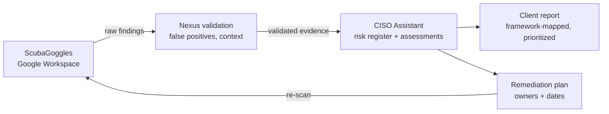

# Framework Mapping: ScubaGoggles Baselines

How to map ScubaGoggles (Google Workspace SCuBA baseline) results to the frameworks Nexus clients care about. This is a **family-level starting point**; validate each mapping against the specific control text before it goes into a client report.

| SCuBA baseline area | NIST CSF 2.0 | NIST SP 800-171 / CMMC L2 | HIPAA Security Rule | SOC 2 (TSC) |
|---|---|---|---|---|
| **Common controls:** 2-Step Verification, super-admin accounts, session length, SSO | PR.AA | 3.1 Access Control, 3.5 Identification & Authentication | §164.312(a) Access control, §164.312(d) Authentication | CC6.1–CC6.3 |
| **Gmail:** SPF/DKIM/DMARC, auto-forwarding, attachment and link protections | PR.DS, PR.PS | 3.13 System & Communications Protection, 3.14 System & Information Integrity | §164.312(e) Transmission security, §164.308(a)(5)(ii)(B) Malicious software | CC6.7, CC6.8 |
| **Drive & Docs:** external sharing, link defaults, shared drives | PR.DS, PR.AA | 3.1 Access Control (3.1.3 control CUI flow) | §164.312(a) Access control | CC6.1, CC6.7 |
| **Meet / Chat / Groups / Sites / Calendar:** external access and visibility | PR.AA, PR.DS | 3.1 Access Control | §164.312(a) Access control | CC6.1 |
| **Audit and alerting** (common controls, alert center) | DE.CM, DE.AE | 3.3 Audit & Accountability | §164.312(b) Audit controls | CC7.2–CC7.3 |
| **Marketplace / third-party app access** | GV.SC, PR.PS | 3.4 Configuration Management | §164.308(b) Business associate contracts (where apps handle PHI) | CC9.2 |

## Notes

- CMMC Level 2 practices align with NIST SP 800-171 requirements; cite the 800-171 requirement number in reports. Confirm whether the client's Workspace edition and configuration are appropriate for CUI before positioning it as in-scope.
- For HIPAA clients, confirm a signed Google Workspace BAA exists and PHI is limited to covered services.
- HIPAA is risk-based. Present findings as inputs to the client's risk analysis, not as pass/fail compliance.

## Framework versions and status (verified 2026-10-31)

Check these before every engagement; regulatory timelines move.

| Framework | Version to assess against | Status that matters for clients |
|---|---|---|
| NIST CSF | **2.0** (Feb 2024) | Adds the *Govern* function; CSF 1.1 category IDs no longer apply. |
| NIST SP 800-171 | **Rev 2** for CMMC; Rev 3 (May 2024) for awareness | CMMC Level 2 practices are defined by **Rev 2**. Use Rev 2 requirement numbers in CMMC reports even though Rev 3 is current. |
| CMMC | **2.0** (32 CFR 170; 48 CFR DFARS rule effective **Nov 10, 2025**) | **Phase 2 starts Nov 10, 2026**: Level 2 third-party (C3PAO) certification becomes a condition of award where required. Phase 3 (Nov 10, 2027) extends it to option periods. |
| HIPAA Security Rule | 45 CFR 164 Subpart C (current rule) | The Jan 2025 proposed overhaul (mandatory MFA, encryption, asset inventory) is **not final**; HHS moved its target to **July 2027**. Recommend the proposed controls as best practice, but assess against the current rule. |
| SOC 2 | AICPA Trust Services Criteria (2017) with **revised points of focus (2022)** | Readiness only; the client's auditor decides. |

## References

Sources are kept to roughly the last four years; re-verify the status column above at each engagement.

- **CISA BOD 25-01** (Dec 2024) requires federal civilian agencies to deploy SCuBA secure configuration baselines for Microsoft 365 and Google Workspace and to report with ScubaGear / ScubaGoggles. Not binding on private clients, but it makes the baseline a defensible federal benchmark. <https://www.cisa.gov/news-events/directives/bod-25-01-implementing-secure-practices-cloud-services>
- NIST (2024). *The NIST Cybersecurity Framework (CSF) 2.0* (CSWP 29). <https://csrc.nist.gov/pubs/cswp/29/the-nist-cybersecurity-framework-csf-20/final>
- Ross, R., & Pillitteri, V. (2024). *Protecting controlled unclassified information in nonfederal systems and organizations* (NIST SP 800-171 Rev. 3). <https://csrc.nist.gov/pubs/sp/800/171/r3/final>
- Department of Defense (2025). *DFARS: Assessing contractor implementation of cybersecurity requirements* (CMMC 48 CFR final rule, effective Nov 10, 2025). Summary and phase dates: <https://www.cooley.com/news/insight/2025/2025-09-25-dod-releases-long-awaited-final-rule-implementing-cybersecurity-maturity-model-certification-contract-clause>
- Fierce Healthcare (2026). *Feds push back HIPAA security rule overhaul to July 2027*. <https://www.fiercehealthcare.com/health-tech/feds-push-back-hipaa-security-rule-overhaul-july-2027>
- AICPA (2022). *2017 Trust Services Criteria (with revised points of focus, 2022)*. Overview: <https://www.barradvisory.com/resource/whats-new-with-soc-2/>
- Nelson, A., Rekhi, S., Souppaya, M., & Scarfone, K. (2025). *Incident response recommendations and considerations for cybersecurity risk management* (NIST SP 800-61r3). <https://csrc.nist.gov/pubs/sp/800/61/r3/final>
